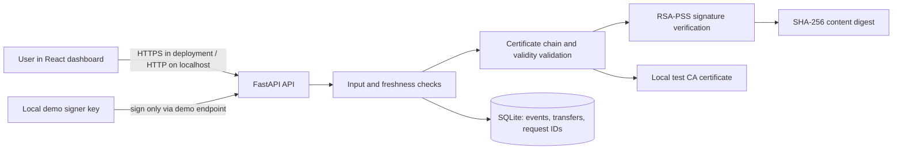

# SecureNet – Network Message and File Integrity Verification System

SecureNet is a locally runnable network security teaching project. It demonstrates how two parties can detect changes to a file or message, how a receiver can decide whether a signing certificate is trusted, and how an API can identify replayed or repeatedly invalid requests. The dashboard is a real React client for the FastAPI service; verification results are calculated from the uploaded bytes, signature, and certificate.

## Objectives and network security relevance

The project demonstrates integrity (detecting byte changes), authenticity (proving the holder of a private key signed the content), certificate trust (checking a signer against a locally trusted CA), secure request freshness (timestamp and unique request ID), replay detection (one use per request ID), and defensive monitoring (durable audit events and temporary IP based rate limiting). These are common building blocks in secure network protocols and file exchange systems. This is an educational local demonstration, not a production PKI or a substitute for TLS termination at a trusted server.

## Architecture and data flow



File signing flow: browser sends a file to the local demo signing endpoint; the server hashes and signs the exact bytes and returns a signature, a public certificate, request ID, and timestamp. File verification sends the bytes and this envelope back. The backend checks that the request is fresh and unused, validates the leaf certificate against the local CA and its validity period, then verifies the RSA-PSS signature over the received bytes. A changed byte makes verification fail. SQLite receives a transfer record and security events record outcomes. Message signing follows the same cryptographic path over UTF-8 message bytes.

## Algorithms and technologies

- **Python / FastAPI:** typed HTTP API, multipart uploads, JSON responses, and local interactive API docs at `http://127.0.0.1:8000/docs`.
- **RSA 2048-bit:** local CA and demo identity keys. Private keys are generated locally on first backend start and stored under ignored `backend/keys/` files.
- **RSA-PSS with MGF1(SHA-256):** randomized RSA signature padding. The signer uses the cryptography package's PSS implementation with maximum permitted salt length.
- **SHA-256:** content digest and the hash used by RSA-PSS. A digest is an integrity fingerprint; it does not by itself prove who created a file.
- **X.509:** a locally generated test CA signs a leaf certificate. Verification checks leaf validity dates, issuer, CA signature, trusted local CA, and RSA key strength. This teaching app implements a one-level local chain.
- **SQLite:** stores verification history, security events, and request IDs used for replay detection.
- **React + Vite:** responsive light dashboard with actual API-backed signing/verification, certificate information, event log, and transfer history.
- **HTTPS/TLS:** the local development server uses HTTP. For a real deployment, terminate HTTPS at a trusted reverse proxy or configure Uvicorn with a real certificate and private key. The application does not silently claim localhost HTTP is TLS.

## Folder structure

```text
SecureNet/
├── backend/
│   ├── main.py                  FastAPI routes and request flows
│   ├── config.py               Environment-backed configuration
│   ├── database.py             SQLite schema and audit helpers
│   └── security/
│       ├── crypto.py            RSA-PSS and SHA-256 operations
│       ├── certificates.py      X.509 trust and expiry checks
│       ├── identity.py          Local CA and demo certificate generation
│       └── monitor.py           In-memory per-IP failure window
├── frontend/
│   ├── src/main.jsx             React dashboard and API calls
│   ├── src/style.css            Responsive light theme
│   ├── .env.example             Optional API base URL
│   ├── package.json             Vite/React dependencies and commands
│   └── vite.config.js
├── tests/test_security_flows.py Positive and negative API demonstrations
├── .env.example                Supported local configuration
├── .gitignore                  Excludes keys, databases, environments, builds
├── requirements.txt            Python dependencies
└── README.md
```

Generated keys, certificates, and SQLite data are created on first backend start and are ignored by Git. **Never copy the demo private keys into source control or use these demo identities for real data.**

## Setup on Windows and VS Code

Install Python 3.11 or newer, Node.js 20 or newer, and VS Code. Open this folder in VS Code (`File → Open Folder`). Open two integrated terminals. In PowerShell, `npm.cmd` avoids machines where the `npm.ps1` execution policy is disabled.

### 1. Configure and install the backend

```powershell
py -3 -m venv .venv
.\.venv\Scripts\Activate.ps1
python -m pip install --upgrade pip
pip install -r requirements.txt
Copy-Item .env.example .env
```

If PowerShell blocks activation, run `Set-ExecutionPolicy -Scope CurrentUser RemoteSigned` in a PowerShell session you control, or use `.venv\Scripts\python.exe -m pip install -r requirements.txt` and `.venv\Scripts\python.exe -m uvicorn backend.main:app --reload --reload-dir backend` without activation. The reload directory is intentionally limited to backend source so changes made while installing packages in `.venv` do not restart Uvicorn.

### 2. Start the API

From the project root:

```powershell
python -m uvicorn backend.main:app --reload --reload-dir backend
```

The API creates `backend/certs/local-ca.pem`, `backend/certs/demo-signer-cert.pem`, an expired test certificate, private keys in `backend/keys/`, and `backend/data/securenet.db` automatically. The keys are random and local. `.env.example` documents database path, certificate and key directories, upload size, rate limit, and browser origins. Its default `ALLOWED_ORIGINS` accepts the common Vite origins using either `localhost` or `127.0.0.1` over HTTP or HTTPS. Copy it to `.env` to customize. If you already have an older `.env`, update its `ALLOWED_ORIGINS` line and restart the backend. Do not commit `.env`.

For a local HTTPS API demonstration after the first startup has generated the development TLS certificate, stop the reload server and run:

```powershell
python -m uvicorn backend.main:app --host 127.0.0.1 --port 8000 --ssl-certfile backend/certs/server-cert.pem --ssl-keyfile backend/keys/server-key.pem
```

The development certificate is signed by `backend/certs/local-ca.pem`, contains `localhost` and `127.0.0.1` names, and is not publicly trusted by browsers by default. Import/trust the local CA only on a disposable development machine if you need a browser with no certificate warning. For production use an organization approved certificate and terminate TLS at a properly configured proxy. To serve the Vite dashboard over HTTPS too, first create the backend TLS files as above, ensure `.env` `ALLOWED_ORIGINS` includes the exact HTTPS dashboard origin (for example `https://localhost:5173`), restart the backend, then open another terminal and run:

```powershell
$env:SECURENET_HTTPS = 'true'
$env:VITE_API_URL = 'https://127.0.0.1:8000/api'
npm.cmd run dev
```

Visit `https://localhost:5173`. The dashboard API base may also be set in the frontend process with `VITE_API_URL` when using another TLS endpoint.

### 3. Start the dashboard

In the second terminal:

```powershell
cd frontend
npm.cmd install
npm.cmd run dev
```

Open `http://localhost:5173`. The API docs are at `http://127.0.0.1:8000/docs`. If the frontend cannot reach the API, confirm both processes are running and the browser origin matches `ALLOWED_ORIGINS` in `.env` (restart the backend after changing it).

## Using the dashboard

The Overview shows live API counts and trust status. Use **Sign file** to generate a test signature and **Choose & verify** to check the same file; modified files fail verification. Signing a message then selecting **Verify signature** exercises the message routes. Certificate details come from the generated certificate, and transfer/event tables refresh every eight seconds. The local demo signing endpoint holds its key server side and returns only the signature and public certificate; it is for practice, not a production key management design.

For click-by-click instructions for every dashboard area and troubleshooting the “API offline” state, see [PROJECT_GUIDE.md](PROJECT_GUIDE.md).

## Security demonstrations

Run all automated flows from the project root after installing requirements:

```powershell
python -m pytest -q
```

The test suite exercises all six requested cases: valid signed file accepted, modified bytes rejected, altered/untrusted certificate rejected, expired certificate rejected, reused request ID rejected, and repeated invalid signatures logged then rate limited. The test server initializes local keys and the SQLite database on startup. To manually repeat a scenario, sign a file through `/api/demo/sign-file` (or the dashboard), then use `/api/verify/file` with its returned metadata. Change one file byte, replace the certificate with `/api/demo/expired-certificate`, or submit the same request ID twice. The default limit is five failed requests per client in 60 seconds; this setting is environment configurable.

## API endpoints

All routes use the `/api` prefix. File endpoints accept multipart form data. The API records failed signature, certificate, replay, and stale timestamp attempts and returns a JSON `detail` with an HTTP error status.

| Method and path | Purpose |
|---|---|
| `GET /api/health` | API and algorithm status |
| `GET /api/overview` | Dashboard totals and event breakdown |
| `GET /api/activity` | Real accepted/rejected file checks by day for the last seven days |
| `GET /api/events?limit=50` | Newest security events |
| `GET /api/transfers?limit=50` | Newest file transfer checks |
| `GET /api/certificates` | Local CA and demo signer certificate details |
| `POST /api/sign/message` | JSON `{"message":"hello"}`; returns signature envelope |
| `POST /api/verify/message` | Form fields: `message`, `signature`, `certificate_pem`, `request_id`, `timestamp` |
| `POST /api/demo/sign-file` | Multipart `file`; returns signature envelope |
| `POST /api/verify/file` | Multipart `file`, `signature`, `certificate_pem`, `request_id`, `timestamp` |
| `GET /api/demo/expired-certificate` | Exposes expired local test certificate for negative tests |

Example sign request:

```powershell
Invoke-RestMethod -Method Post -Uri http://127.0.0.1:8000/api/sign/message -ContentType 'application/json' -Body '{"message":"hello SecureNet"}'
```

Successful verification returns HTTP 200 with `valid: true`, SHA-256, certificate identity, and an acceptance message. An invalid signature, untrusted or expired certificate, or replay is rejected with HTTP 400 (or HTTP 429 after repeated failures). Timestamps must be ISO-8601 and within five minutes of server time. Request IDs are single-use, including failed attempts after freshness checking.

## Troubleshooting

- **`ModuleNotFoundError`:** activate the project `.venv` and run `pip install -r requirements.txt` from the root.
- **API health works but the dashboard says API offline:** this usually means the browser blocked the request due to CORS or an HTTP/HTTPS mismatch. Compare the browser's exact dashboard origin (scheme, host, and port) with `ALLOWED_ORIGINS` in root `.env`; include `http://127.0.0.1:5173` if you opened that host, then restart Uvicorn. The default example includes the usual localhost and 127.0.0.1 Vite origins for HTTP and HTTPS.
- **Frontend says API unreachable:** start Uvicorn, use the shown local API address, and check `ALLOWED_ORIGINS`.
- **`npm` script blocked:** use `npm.cmd` in PowerShell, or configure the shell's execution policy.
- **Upload too large:** lower the file size or set `MAX_UPLOAD_MB` in `.env`, then restart the API.
- **Unexpected expired/untrusted certificate:** certificates are generated on first start. Confirm system date/time and do not replace the local CA file while keeping older leaf certificates.
- **Rate limited during practice:** wait for the configured window; default 60 seconds. The limiter is intentionally in memory and resets when the API restarts.
- **Database reset for a fresh demo:** stop the backend and delete `backend/data/securenet.db`; generated certificates and keys can remain trusted by the rebuilt database.

## Limitations and future improvements

This is a student demo. The local development API is HTTP, the demo signing private key is stored unencrypted on the same machine, rate limiting is in memory and per process, timestamps rely on the host clock, replay IDs are retained indefinitely in SQLite, and certificate validation supports a simple one-level local CA rather than full RFC-compliant path building, revocation, name constraints, or OCSP/CRL. SQLite and the demo CA are not designed for concurrent production deployment. Configure real HTTPS, protect keys in a keystore/HSM, use per-user identities and access controls, add revocation and complete path validation, implement durable distributed rate limiting, enforce retention/cleanup policies, and add deployment hardening before using this pattern outside a classroom.
